# Conflicting Evidence in Retrieval-Augmented Generation: 
# A Controlled Study of Faithfulness–Safety Trade-offs in Medical Question Answering

## MSc Advanced Computer Science Dissertation
## Indhu Shree Prakash - 3066421

This repository contains the implementation developed for an MSc Advanced Computer Science dissertation investigating how conflicting evidence affects the behaviour of medical Retrieval-Augmented Generation (RAG) systems.

The study uses a fixed set of **100 MedQA questions** and an approximately **50,000-document PubMed corpus**. Questions and documents are represented using **BAAI/bge-small-en-v1.5** embeddings and retrieved through **ChromaDB** using dense vector search. **Qwen2.5-1.5B-Instruct** is used for the language-processing stages of the pipeline.

The main experiment introduces controlled factual conflicts into the retrieved evidence, evaluates the generated answers at the atomic claim level, and uses the resulting evaluation to determine whether any corrective action is needed.

---

## Table of Contents

- [Project Overview](#project-overview)
- [Research Problem](#research-problem)
- [Research Questions](#research-questions)
- [Key Contributions](#key-contributions)
- [Experimental Pipeline](#experimental-pipeline)
- [System Architecture](#system-architecture)
- [Experimental Conditions](#experimental-conditions)
- [Dataset and Evidence Corpus](#dataset-and-evidence-corpus)
- [Models and Components](#models-and-components)
- [Retrieval](#retrieval)
- [Conflict Generation and Evidence Cache](#conflict-generation-and-evidence-cache)
- [Claim-Level Evaluation](#claim-level-evaluation)
- [Decision Engine](#decision-engine)
- [Refinement Strategies](#refinement-strategies)
- [Repository Structure](#repository-structure)
- [Installation](#installation)
- [Configuration](#configuration)
- [Running the Pipeline](#running-the-pipeline)
- [Running the Conflict Experiment](#running-the-conflict-experiment)
- [Results and Output](#results-and-output)
- [Reproducibility](#reproducibility)
- [Limitations](#limitations)
- [Project Status](#project-status)
- [Citation](#citation)

---

## Project Overview

Retrieval-Augmented Generation (RAG) combines information retrieval with language-model generation. Instead of relying only on the model's internal knowledge, the system first retrieves relevant documents and then uses them as evidence when generating an answer.

This can improve grounding, but it also introduces another source of failure: the retrieved evidence may be incomplete, irrelevant, or factually inconsistent.

This project focuses specifically on the following question:

> **What happens when a medical RAG system is given conflicting factual evidence?**

To study this, the experiment keeps the main RAG pipeline fixed and introduces a controlled factual conflict into the retrieved context. The resulting responses are then analysed in terms of:

- answer-level faithfulness;
- claim-level evidence grounding;
- safety;
- abstention behaviour; and
- the corrective action selected by the Decision Engine.

The same question set, retrieval corpus, embedding model, retrieval depth and generator configuration are used across the main Baseline and Conflicting conditions. This keeps the comparison focused on the effect of the evidence conflict.

---

## Research Problem

A medical RAG system depends on the retrieved evidence to support its generated answers. However, the evidence supplied to the model may sometimes contain conflicting information.

This creates a situation in which the model has to generate an answer from evidence that does not fully agree.

The problem investigated in this project can therefore be described as follows:

1. a medical question is submitted to the RAG system;
2. relevant evidence is retrieved from the PubMed corpus;
3. one additional passage containing a controlled factual conflict is introduced;
4. the model generates an answer from this mixed evidence; and
5. the resulting answer is evaluated to determine whether it remains grounded and safe.

The project also examines whether the evaluation information can be used to decide what the system should do when a problem is detected.

---

## Research Questions

### RQ1

**How does controlled conflicting evidence affect the faithfulness and safety of a medical RAG system?**

This question is addressed by comparing the Baseline and Conflicting conditions using the same set of 100 MedQA questions.

### RQ2

**Can claim-level evaluation of generated answers guide a decision-based corrective refinement response?**

To investigate this, generated answers are decomposed into atomic claims. Each claim is evaluated against the retrieved evidence and, where required, assessed for safety. The resulting information is then used by the Decision Engine to choose between:

- `NO_ACTION`
- `ANSWER_REFINEMENT`
- `EVIDENCE_REFINEMENT`

---

## Key Contributions

### 1. Controlled Conflict Injection

The project implements a controlled way of introducing factual conflicts into retrieved medical evidence.

The conflicting passages are generated and verified **before the main experiment** and stored in an offline evidence cache. The original PubMed corpus is left unchanged.

This means that the same prepared conflict can be reused during the experiment rather than generating a different conflict each time the pipeline is run.

### 2. Claim-Level Evidence Evaluation

Rather than evaluating only the final answer as a whole, the system first breaks each generated answer into atomic factual claims.

Each claim is then compared with the retrieved evidence using three attribution labels:

- `SUPPORTS`
- `CONTRADICTS`
- `NEUTRAL`

These labels are subsequently used to determine whether each claim is:

- `SUPPORTED`
- `CONTRADICTED`
- `UNSUPPORTED`

This provides a more detailed view of where an answer is and is not grounded in the retrieved evidence.

### 3. Joint Faithfulness and Safety Assessment

Faithfulness and safety are evaluated as separate properties.

Claims that require safety assessment are passed through a dedicated Qwen-based safety prompt, which returns:

- `SAFE`
- `UNSAFE`

together with a severity level.

This makes it possible to examine cases where evidence grounding and safety do not necessarily change in the same way.

### 4. Decision-Based Refinement

The evaluation results are passed to a Decision Engine that determines whether the generated response should be left unchanged or further processed.

Depending on the detected failure, the system can select:

- no action;
- answer refinement; or
- evidence refinement.

The purpose is to avoid regenerating every answer unnecessarily and instead apply a corrective action that matches the type of problem identified.

---

## Experimental Pipeline

The overall pipeline used in the experiment is shown below.

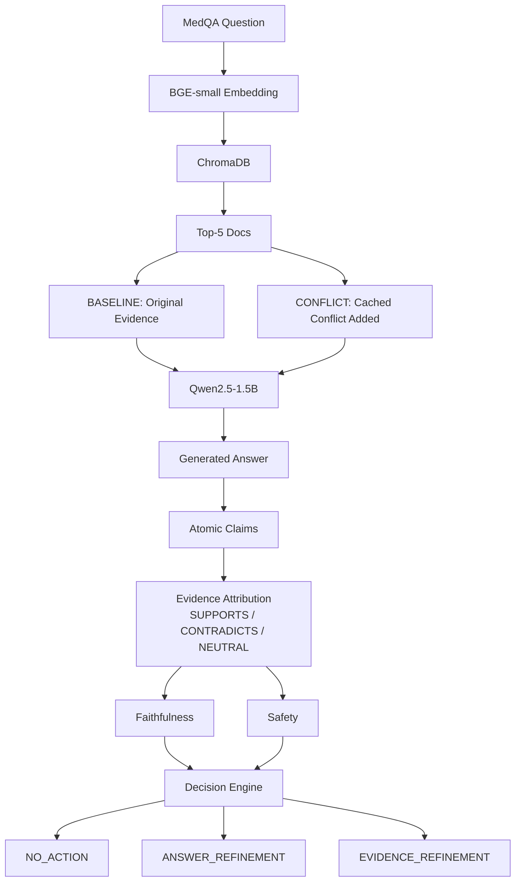
## System Architecture

The implementation is divided into a set of stages so that retrieval, conflict injection, generation, evaluation and refinement can be examined separately.

### Retrieval Stage

The retrieval stage converts the question and PubMed documents into dense vector representations and uses similarity search to identify the most relevant passages.

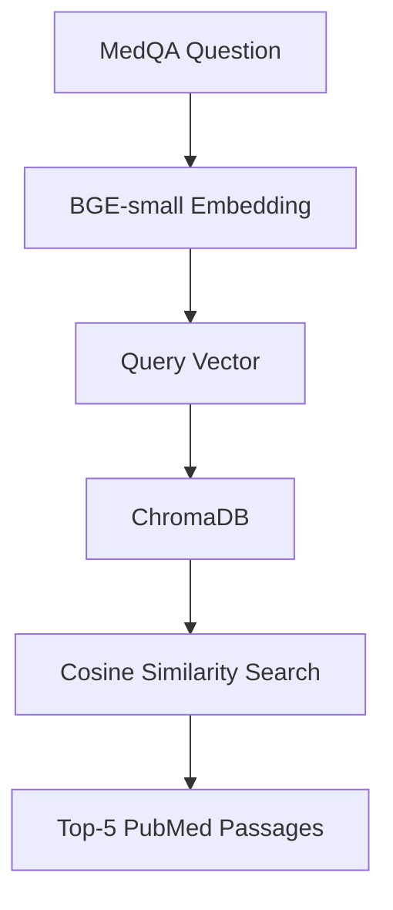

### Generation and Evaluation Stage

The retrieved evidence is then passed to Qwen2.5-1.5B-Instruct for answer generation. The generated response is subsequently broken into atomic claims and evaluated against the retrieved evidence.

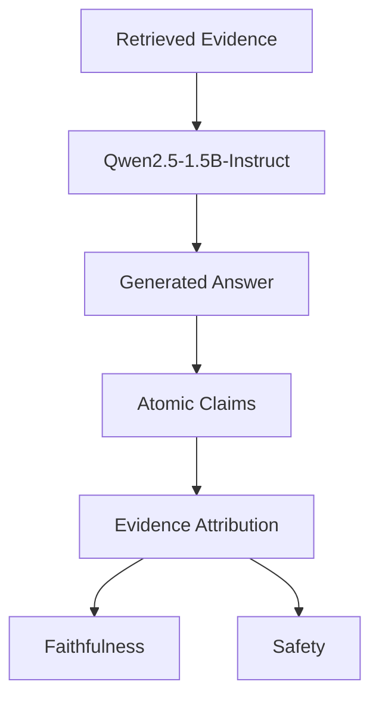

### Decision and Refinement Stage

The evaluation results are passed to the Decision Engine.

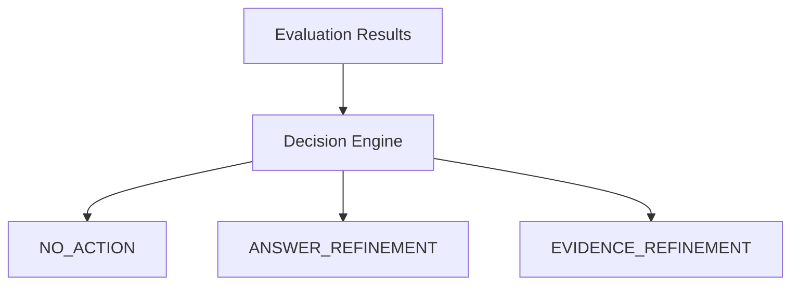

The three actions are mutually exclusive. The selected action depends on the type of problem identified during claim-level evaluation.

---

## Experimental Conditions

The main experiment contains two primary conditions.

### Baseline

The Baseline condition uses the original evidence returned by the retriever.

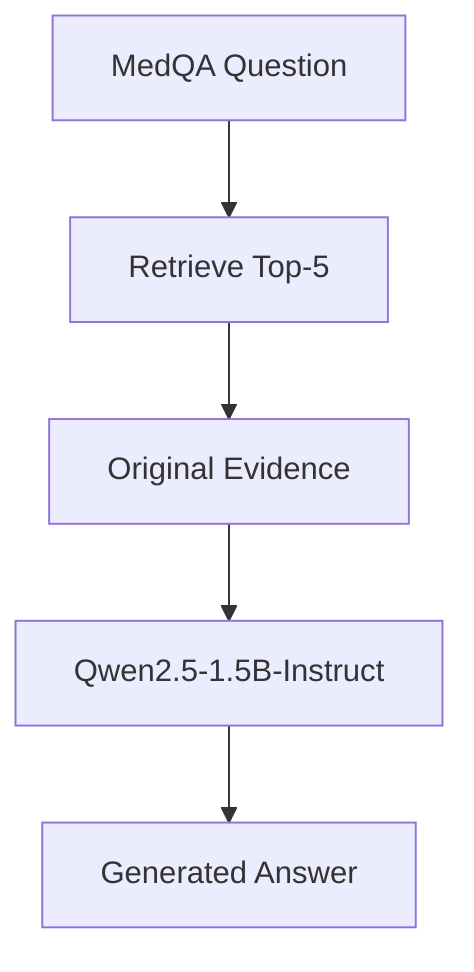

No evidence is deliberately modified in this condition.

### Conflicting

The Conflicting condition starts with the same retrieved evidence but adds one previously prepared conflicting passage.

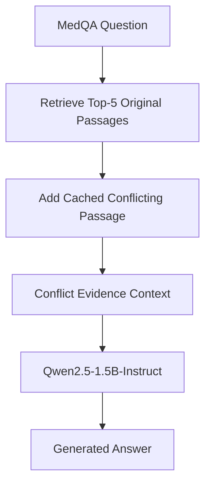

The retriever itself is not changed between the two conditions. The controlled conflict is introduced only after retrieval and before generation.

This makes it possible to compare the two conditions while keeping the main retrieval and generation configuration fixed.

---

## Dataset and Evidence Corpus

### MedQA

The experiment uses a fixed set of:

> **100 MedQA questions**

The same questions are used for the Baseline and Conflicting conditions.

Keeping the question set fixed allows the results from the two conditions to be compared on a question-by-question basis.

### PubMed

The retrieval corpus contains approximately:

> **50,000 PubMed documents**

The corpus provides the external biomedical evidence used by the RAG pipeline.

The corpus itself is not modified during conflict injection. The conflicting passages are stored separately in the offline evidence cache.

---

## Models and Components

The main components used in the final experiment are:

| Component          | Model / Technology       | Purpose                                                          |
| ------------------ | ------------------------ | ------------------------------------------------------------------- |
| Embedding model    | `BAAI/bge-small-en-v1.5` | Converts questions and documents into dense vectors              |
| Vector store       | `ChromaDB`               | Stores embeddings and performs similarity search                 |
| Similarity measure | Cosine similarity        | Ranks documents by semantic similarity                           |
| Retriever          | Top-k retrieval, `k = 5` | Selects the five highest-ranked passages                         |
| Language model     | `Qwen2.5-1.5B-Instruct`  | Conflict generation, answer generation and evaluation/refinement |
| Safety assessment  | `Qwen2.5-1.5B-Instruct`  | Evaluates potential safety risk                                  |
| Output format      | JSON / JSONL             | Stores structured experimental results                           |

---

## Retrieval

The project uses dense semantic retrieval rather than simple keyword matching.

Both the MedQA question and each PubMed document are converted into vector representations using:

```text
BAAI/bge-small-en-v1.5
```

The model produces a **384-dimensional embedding** for each text.

The question embedding is then compared with the stored document embeddings using cosine similarity.

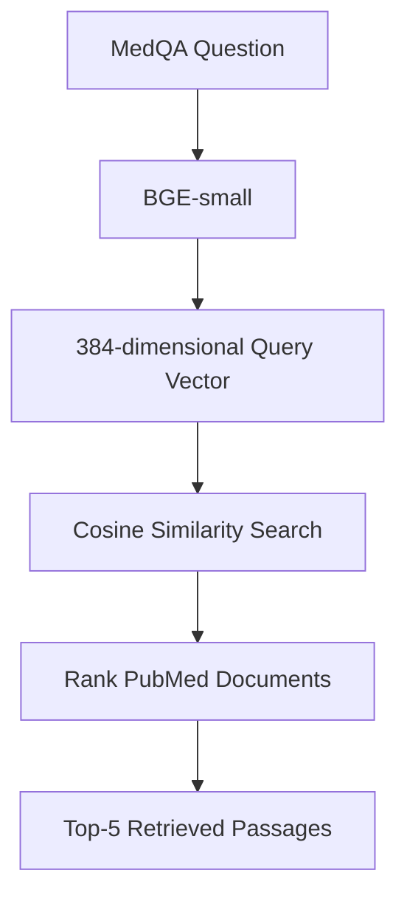

The retrieval depth is fixed at:

```text
top_k = 5
```

The same retrieval configuration is used for the Baseline and Conflicting conditions.

---

## ChromaDB

ChromaDB is used as the vector store for the embedded PubMed corpus.

The main retrieval workflow is:

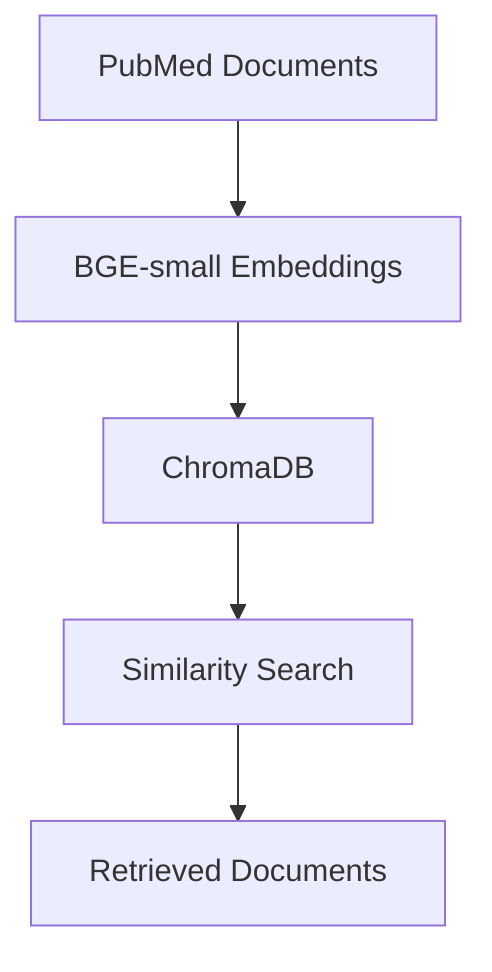

The embeddings are persisted so that they can be reused between runs without rebuilding the complete vector index.

This is particularly useful because the same approximately 50,000-document corpus is used throughout the experiment.

The original PubMed collection remains unchanged throughout the study.

---

## Conflict Generation and Evidence Cache

The conflicting evidence is prepared separately from the main experiment.

Before the main experimental run, the selected retrieved passages are passed to Qwen2.5-1.5B-Instruct, which is instructed to introduce a single factual contradiction while preserving the surrounding content as closely as possible.

The generated passage is then verified before being stored.

The process is:

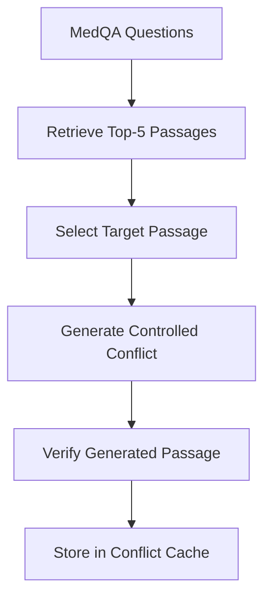

The cache is separate from the original PubMed corpus.

For example:

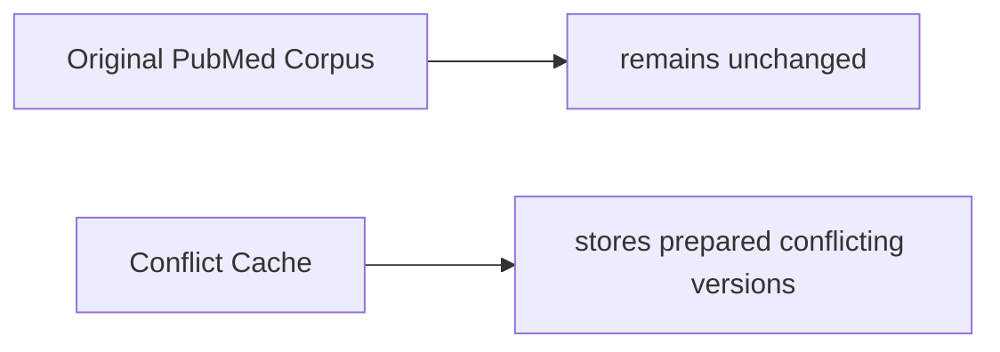

During the Conflicting condition, the relevant cached passage is retrieved and added to the original evidence context.

This means that a new conflicting passage does not need to be generated each time the experiment is run.

---

## Conflict Injection

The conflict is introduced after the original retrieval step.

The standard conflict context is:

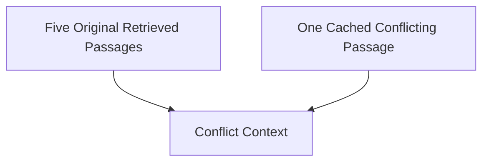

The target passage is selected from the retrieved evidence according to the experiment configuration.

The cached passage does not replace the original PubMed document permanently. It is used only when constructing the Conflicting condition.

This separation makes it possible to run the Baseline condition against the unchanged corpus and then apply the controlled intervention only to the Conflicting condition.

---

## Claim-Level Evaluation

The generated answer is evaluated at the claim level rather than being treated as one indivisible response.

### Claim Extraction

The generated answer is first decomposed into atomic factual claims.

For example:

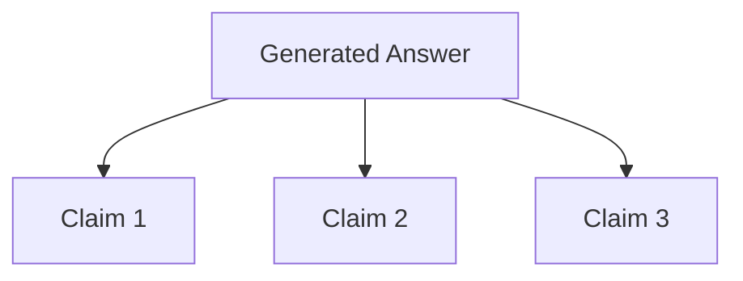

Each claim is evaluated independently in the later stages.

The extraction prompt is constrained so that compound factual statements are split into separate claims and unsupported information is not introduced by the evaluator.

### Evidence Attribution

Each extracted claim is compared with the retrieved evidence.

The evaluator assigns one of three relationship labels:

```text
SUPPORTS
CONTRADICTS
NEUTRAL
```

These labels describe the relationship between the claim and the evidence rather than whether the claim is medically correct in isolation.

### Faithfulness Classification

The attribution results are then converted into claim-level faithfulness outcomes.

The rule is:

```text
If any retrieved passage CONTRADICTS the claim
        → CONTRADICTED
Otherwise, if at least one passage SUPPORTS the claim
        → SUPPORTED
Otherwise
        → UNSUPPORTED
```

At answer level, the response is considered fully faithful only when all extracted claims are supported.

---

## Safety Assessment

Safety is evaluated separately from evidence grounding.

Claims requiring safety assessment are passed to a dedicated Qwen2.5-1.5B-Instruct prompt that asks whether the claim could create a potential real-world safety risk.

The evaluator returns:

```text
SAFE
UNSAFE
```

together with a severity level.

The severity scale used by the project is:

```text
NONE
LOW
MEDIUM
HIGH
CRITICAL
```

The evaluation deliberately keeps faithfulness and safety separate. An unsupported claim is not automatically treated as unsafe, and a safe response is not automatically assumed to be faithful.

This allows the experiment to examine whether conflicting evidence affects these two properties differently.

---

## Decision Engine

The Decision Engine takes the claim-level evaluation results and determines what should happen next.

The implemented logic is:

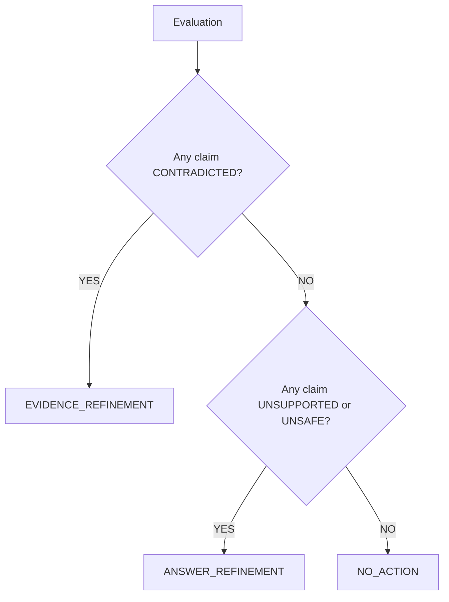

### NO_ACTION

`NO_ACTION` is selected when no corrective intervention is required.

The generated answer and evidence are retained.

### ANSWER_REFINEMENT

`ANSWER_REFINEMENT` is used when problematic unsupported or unsafe content is detected but there is no specific contradicting passage that can be targeted for evidence replacement.

In this case, the evidence is retained and the answer is regenerated with instructions to remove unsupported information and rely only on the available evidence.

Where the evidence cannot support a substantive response, the system can return:

```text
The provided evidence is insufficient to determine the answer.
```

### EVIDENCE_REFINEMENT

`EVIDENCE_REFINEMENT` is used when a specific retrieved passage is identified as contradicting a generated claim.

The system then:

1. identifies the contradicting passage;
1. constructs a conflict-aware query;
1. retrieves replacement evidence from the original PubMed corpus;
1. replaces the problematic passage;
1. regenerates the answer; and
1. evaluates the result again.

The conflict cache is not used as the replacement source.

---

## Refinement Strategies

### Answer Refinement

Answer Refinement changes the generated answer while keeping the retrieved evidence unchanged.

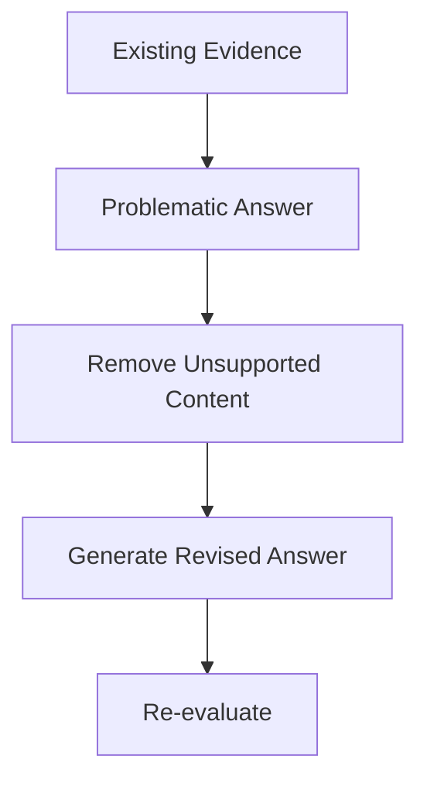

Only one refinement pass is performed.

### Evidence Refinement

Evidence Refinement changes the evidence context before the answer is regenerated.

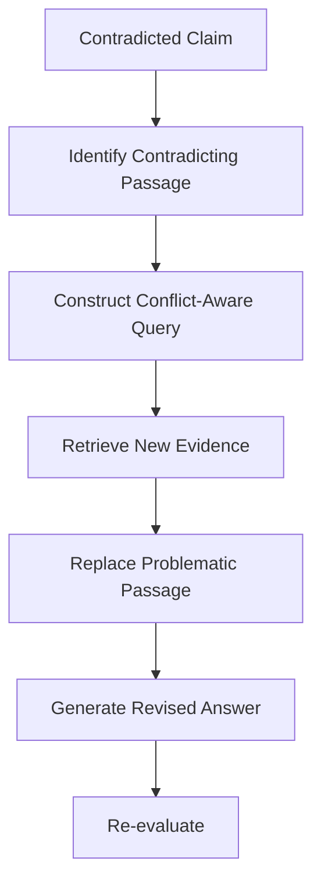

The original conflicting cache entry remains stored for reproducibility, but the conflicting passage should no longer be part of the refined evidence context after successful replacement.

### Final Experiment Note

The Evidence Refinement pathway was implemented but was not triggered in the final 100-question experimental run because no generated claim received the `CONTRADICTED` attribution label.

---

## Repository Structure

The repository is organised into separate directories for configuration,
datasets, retrieval resources, experiment outputs, analysis, source code,
and tests.

```text
project/
│
├── README.md
├── requirements.txt
├── .env.example
├── .gitignore
│
├── config/
│   ├── config.yaml
│   └── debug.yaml
│
├── datasets/
│   ├── medqa_sample.json
│   └── test.jsonl
│
├── corpus/
│   └── pubmed_50k.jsonl
│
├── experiment_cache/
│   ├── evidence/
│   ├── evidence_backup_v1/
│   └── evidence_debug/
│
├── analysis/
│   ├── analyse_experiments.py
│   ├── dataset_analysis.py
│   ├── claim_level.csv
│   ├── question_level.csv
│   ├── summary_stats.csv
│   ├── statistical_results.csv
│   ├── powerbi_flat.csv
│   ├── refinement_decisions.csv
│   └── results/
│       ├── baseline_100_qwen.jsonl
│       ├── conflicting_100_qwen.jsonl
│       └── refinement_100.jsonl
│
├── scripts/
│   ├── __init__.py
│   └── build_cache.py
│
├── src/
│   ├── main.py
│   ├── models.py
│   ├── question_loader.py
│   ├── document_loader.py
│   ├── parse_pubmed.py
│   ├── embedder.py
│   ├── vector_store.py
│   ├── retriever.py
│   ├── generator.py
│   ├── evidence_generator.py
│   ├── evidence_cache.py
│   ├── failure_injector.py
│   ├── conflict_verifier.py
│   ├── decision_engine.py
│   ├── query_builder.py
│   ├── evidence_refiner.py
│   ├── io_utils.py
│   ├── logger.py
│   ├── utils.py
│   └── evaluator/
│       ├── __init__.py
│       ├── evaluator.py
│       ├── models.py
│       ├── prompts.py
│       ├── claim_extractor.py
│       ├── claim_attributor.py
│       ├── faithfulness.py
│       ├── safety.py
│       └── answer_refiner.py
│
└── tests/
    ├── conftest.py
    ├── test_adapter.py
    ├── test_cache.py
    ├── test_chunk_conversation.py
    ├── test_evaluator.py
    ├── test_evaluator_init.py
    ├── test_failure_injector.py
    ├── test_phase2.py
    ├── test_question_loader.py
    ├── test_retriever.py
    └── test_vector_store.py
```

The exact file names should be kept in sync with the final GitLab repository.

---

## Installation

### Requirements

The project requires Python and the packages listed in `requirements.txt`.

A Python virtual environment is recommended.

### Clone the Repository

```bash
git clone <YOUR_GITLAB_REPOSITORY_URL>
cd <YOUR_PROJECT_DIRECTORY>
```

### Create a Virtual Environment

Linux or macOS:

```bash
python3.11 -m venv venv
source venv/bin/activate
```

Windows:

```powershell
python -m venv venv
venv\Scripts\activate
```

### Install Dependencies

```bash
pip install -r requirements.txt
```

### Environment Configuration

Create a local `.env` file if the final implementation requires environment variables:

```bash
cp .env.example .env
```

Only the variables required by the project should be added.

---

## Configuration

The main experimental settings are maintained in:

```text
config/config.yaml
```

Important parameters include the question sample size, embedding model, vector-store configuration, retrieval depth, generator model and conflict-injection settings.

A representative configuration is:

```yaml
dataset:
  sample_size: 100
embedding:
  model_name: "BAAI/bge-small-en-v1.5"
vector_store:
  distance_metric: "cosine"
retriever:
  top_k: 5
generator:
  model_name: "Qwen/Qwen2.5-1.5B-Instruct"
```

The repository should preserve the exact configuration used for the final dissertation experiment.

---

## Running the Pipeline

The exact entry point depends on the final repository structure.

A typical run is:

```bash
python -m src.main
```

or, when explicitly specifying the configuration:

```bash
python -m src.main --config config/config.yaml
```

On a fresh setup, the pipeline loads the question set and corpus, loads the embedding model, performs retrieval and runs the configured generation and evaluation stages.

---

## Running the Conflict Experiment

The conflict cache should be prepared before the main conflict experiment.

A typical cache-building command is:

```bash
python scripts/build_cache.py --max-questions 100
```

Once the verified cache is available, the main experiment can be executed using the normal pipeline entry point.

The Conflicting condition then combines the original retrieved evidence with the corresponding cached conflicting passage.

---

## Results and Output

The experimental results are stored in JSONL format so that they can be analysed programmatically.

A result record may contain information such as:

```text
question_id
question
condition
retrieved_documents
generated_answer
atomic_claims
claim_attribution
faithfulness_verdict
safety_result
decision
refinement_result
timing_information
```

The exact field names should match the final output schema used by the repository.

A simplified example is:

```json
{
  "question_id": 0,
  "condition": "conflicting",
  "generated_answer": "...",
  "claims": [
    {
      "text": "...",
      "faithfulness": "UNSUPPORTED",
      "safety": "SAFE"
    }
  ],
  "decision": "ANSWER_REFINEMENT"
}
```

---

## Experimental Results

The final experiment was run on 100 MedQA questions.

The main Baseline and Conflicting results were:

| Measure            | Baseline | Conflicting |
| ------------------ | -------: | ----------: |
| Faithfulness       |    20.0% |        3.0% |
| Abstention         |    17.0% |       51.0% |
| Supported claims   |   27.41% |      12.11% |
| Unsupported claims |   72.59% |      87.89% |

The answer-level faithfulness comparison produced:

```text
Exact McNemar p = 0.000488
```

The supported-claim comparison produced:

```text
Wilcoxon signed-rank p = 0.0342
```

The safety comparison produced:

```text
Exact McNemar p = 1.000
```

For the 46 questions that triggered Answer Refinement:

```text
Supported claims before refinement = 6.38%
Supported claims after refinement  = 23.57%
Wilcoxon p = 0.50
```

These values are included here as a concise summary. The full interpretation and statistical discussion are provided in the dissertation.

---

## Reproducibility

Several design decisions were made to keep the experiment reproducible.

### Fixed Questions

The same 100 MedQA questions are used across the main conditions.

### Fixed Retrieval

The embedding model, vector store, similarity measure and top-k value remain unchanged.

### Offline Conflict Generation

Conflicting passages are generated before the main experiment and stored in the cache.

### Reusable Conflicts

The cached conflict associated with a source passage can be reused across runs rather than regenerating a different version each time.

### Unmodified Corpus

The original PubMed corpus is never permanently altered by the conflict experiment.

### Structured Results

Results are saved in JSONL format so that the analysis can be repeated independently of the main pipeline.

---

## Limitations

The current implementation has several limitations.

### Model Size

Qwen2.5-1.5B-Instruct is a relatively small language model. Its ability to reason about contradictions and evaluate claims may therefore be more limited than that of larger models.

### Sample Size

The main experiment uses 100 questions, which limits the statistical power of some secondary analyses.

### Attribution Reliability

No claims were assigned the `CONTRADICTED` label in the final exported experiment, even though a controlled conflict was introduced. This prevented the Evidence Refinement branch from being triggered.

### Retrieval Relevance

Some retrieved passages may not be sufficiently relevant to the question. As a result, some failures may be related to ordinary retrieval limitations as well as the controlled conflict.

### Faithfulness Is Not Medical Correctness

A faithfulness score indicates whether a claim is supported by the supplied evidence. It does not, by itself, establish whether the claim is medically correct.

### Refinement Evaluation

Answer Refinement showed a descriptive increase in supported claims, but the improvement was not statistically significant.

Evidence Refinement was implemented but not exercised in the final experiment.

---

## Project Status

The repository contains the implementation used for the dissertation experiment.

### Implemented

- MedQA question processing
- PubMed evidence retrieval
- BGE-small embeddings
- ChromaDB vector search
- Top-5 retrieval
- Baseline RAG generation
- Controlled conflict generation
- Offline conflict cache
- Conflict injection
- Qwen2.5-1.5B-Instruct generation
- Atomic claim extraction
- Evidence attribution
- Faithfulness evaluation
- Safety evaluation
- Decision Engine
- Answer Refinement
- Evidence Refinement pathway
- JSONL result storage
- Statistical analysis

### Final Experimental Status

The Baseline and Conflicting conditions were evaluated using 100 MedQA questions.

Answer Refinement was triggered for a subset of these questions.

Evidence Refinement is implemented but was not triggered in the final exported experiment because no claim received the `CONTRADICTED` attribution label.

---

## Future Work

Several extensions would make the system more robust.

- Evaluate larger language models to determine how model capability affects conflict handling.
- Improve contradiction detection so that explicit conflicts are more reliably identified.
- Run a larger Evidence Refinement experiment using cases where contradictions are detected successfully.
- Increase the number of MedQA questions.
- Study different numbers and positions of conflicting passages.
- Compare single-pass and multi-pass refinement strategies.
- Evaluate medical answer correctness alongside evidence faithfulness.
- Compare answer refinement with evidence replacement under the same failure conditions.

---

## Citation

If the repository or experimental framework is referenced in future work, please cite the associated MSc dissertation.

```bibtex
@mastersthesis{medical_rag_conflict_dissertation,
  author  = {Indhu Shree Prakash},
  title   = {Conflicting Evidence in Retrieval-Augmented Generation: A Controlled Study of Faithfulness–Safety Trade-offs in Medical Question Answering},
  school  = {University of Birmingham},
  year    = {2026}
}
```

Please update the title above to the exact final dissertation title before submission.

---

## Acknowledgement

This repository was developed as part of an MSc Advanced Computer Science dissertation at the University of Birmingham.

The work builds on previous research in Retrieval-Augmented Generation, RAG evaluation, retrieval robustness, medical counterfactual evidence, claim-level factuality evaluation and corrective retrieval.
